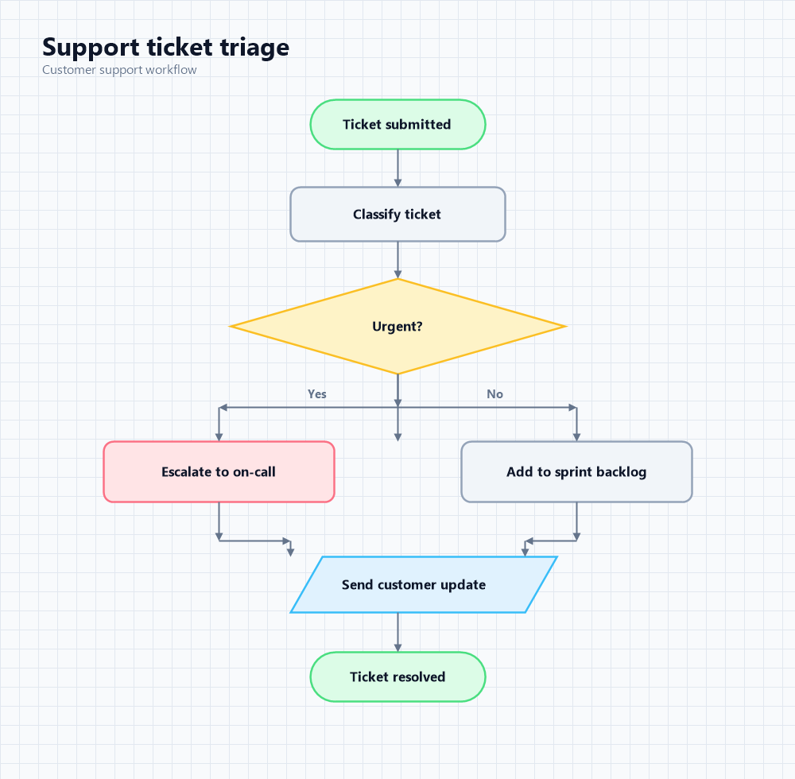

# ChatGPT's Flowcharts Generator

A browser-only flowchart workspace for students and makers. Turn a screenshot,
a rough workflow description, or Mermaid code into a clean, editable diagram,
then export it as PNG, SVG, PDF, Mermaid, or JSON.

The app is a **static React build with no backend**. Demo mode works offline
once the page is loaded and needs no account, API key, database, or paid
hardware. Hugging Face AI is optional.



## Features

- **Screenshot reconstruction** — upload or paste a PNG/JPG/JPEG/WEBP file
  (drag and drop or `Ctrl+V`) and convert the visible flowchart into editable
  nodes and edges. The screenshot is never used as the exported result.
- **Paste workflow text** — a deterministic local parser handles numbered
  steps, "if/otherwise" branches, and common action verbs. A Mermaid detector
  automatically converts `flowchart` / `graph` syntax.
- **Describe a process** — demo mode builds a starting diagram locally; with a
  Hugging Face token, a text model generates a more nuanced diagram.
- **Full editor** — add, delete, rename, drag, and connect nodes; six shapes
  (start/end, process, decision, input/output, document, connector); six colors;
  zoom, pan, fit-to-view, and Dagre auto-layout in vertical or horizontal mode.
- **Undo / redo** — `Ctrl+Z`, `Ctrl+Shift+Z`, and `Ctrl+Y`, with drag and label
  edits grouped into single history entries.
- **Mermaid workspace** — generate Mermaid from the canvas, edit it, preview it
  with Mermaid's renderer, copy/download `.mmd`, or apply it back as nodes.
- **AI assistant** — local quick actions (layout, add branch, add error step,
  simplify, explain) work without a token. With a token, ask for custom diagram
  changes or an AI explanation.
- **Exports** — PNG, SVG, PDF, Mermaid, and JSON. Exports use only the diagram,
  never the uploaded screenshot.
- **Light/dark mode**, responsive layout, keyboard shortcuts, and a clean UI with
  no placeholder buttons.

## Tech stack

- React 19 + TypeScript + Vite
- Tailwind CSS
- React Flow (`@xyflow/react`) for the editor
- Dagre (`@dagrejs/dagre`) for automatic layout
- Mermaid (lazy-loaded) for Mermaid preview
- `html-to-image` + `jsPDF` (lazy-loaded) for image/PDF export
- Lucide React icons
- Hugging Face Inference Providers through the OpenAI-compatible router

## Run locally

Requirements: Node.js 20+ and npm.

```bash
npm install
npm run dev
```

Open the URL printed by Vite (usually `http://localhost:5173`).

```bash
npm run build    # type-check + production build into dist/
npm run preview  # serve the production build locally
```

## Demo mode vs AI mode

Demo mode is the default and is fully usable:

| Feature | Demo mode | With a Hugging Face token |
| --- | --- | --- |
| Start from a sample diagram | Yes | Yes |
| Workflow text → diagram | Local rule-based parser | AI structuring or local parser |
| Description → diagram | Local demo generator | AI generation or local generator |
| Screenshot → diagram | Sample screenshot demo | Vision model reconstruction |
| AI assistant | Local quick actions only | Custom modifications and explanations |
| Editor + exports | Yes | Yes |

The sample screenshot button reconstructs the support-ticket flow locally, so
the screenshot workflow can be demonstrated without credentials. Your own
screenshots require a vision-capable token.

## Optional Hugging Face AI setup

1. Create a Hugging Face account and a **fine-grained access token** with
   permission to use Inference Providers:
   <https://huggingface.co/settings/tokens/new?ownUserPermissions=inference.serverless.write&tokenType=fineGrained>
2. Open the app, click **Demo mode** in the header, paste the token, and save.
3. The token is kept in React state for the current tab only. It is never
   written to `localStorage`, `sessionStorage`, a cookie, the build output, or
   this repository. Refreshing or closing the tab clears it.
4. Inference usage may consume Hugging Face credits depending on your account.

Default models:

- Text/reasoning: `openai/gpt-oss-20b`
- Vision: `Qwen/Qwen3-VL-30B-A3B-Instruct`

Both are editable under **AI settings → Model settings**. Any chat-completions
model available through Hugging Face Inference Providers can be used. The app
calls `https://router.huggingface.co/v1/chat/completions` directly from the
browser; the router returns browser-friendly CORS headers.

If a request fails, the UI explains common statuses (401 token, 402/403 credits
or permissions, 404 unavailable model, 429 rate limit, 5xx provider outage) and
suggests demo mode.

## Deploy as a Hugging Face Static Space

This project intentionally has no Dockerfile, backend, auth, or database. A
static Space only needs the built files at its repository root.

### Option A — upload the build manually

```bash
npm install
npm run build
```

1. Create a new **Static** Space on Hugging Face.
2. Copy the **contents** of `dist/` (not the folder itself) into a clone of the
   Space repository.
3. Add a Space `README.md` whose front matter includes `sdk: static` (the YAML
   block at the top of this file is a valid starting point).
4. Commit and push the Space repository. Hugging Face serves `index.html` from
   the repository root.

`vite.config.ts` sets `base: './'`, so the app also works when the Space is
served from a sub-path.

### Option B — push the full project to GitHub first

Keep this repository as the source of truth, then publish a build to the Space:

```bash
npm run build
cd dist
git init
git add .
git commit -m "Deploy static build"
git branch -M main
git remote add space https://huggingface.co/spaces/<username>/<space-name>
git push space main
```

Remember to include a `README.md` with the `sdk: static` metadata in the Space
repository. Do not commit a Hugging Face token or any `.env` file.

The GitHub source repository for this project is:
<https://github.com/mithun-27/chatgpt-s_flowcharts_generator>

## How screenshot reconstruction works

1. The image is validated (type and 10 MB limit), read in the browser, and
   downscaled to a maximum dimension of 1600 px before upload.
2. The vision model receives a strict prompt that asks for JSON containing
   labels, shapes, colors, and directed edges — no coordinates.
3. The response is parsed defensively: invalid shapes/colors fall back to safe
   defaults, labels are cleaned, ids are remapped, duplicate/self edges are
   dropped, and node/edge counts are capped.
4. Dagre lays out the result. React Flow renders new, fully editable nodes and
   edges. The source image is discarded.

## Project structure

```text
src/
  components/       Header, input tabs, editor, toolbar, dialogs, assistant
  editor/           Dagre layout, node theme, undo/redo reducer, action context
  services/         Hugging Face client, AI/vision calls, exporters, Mermaid preview
  types/            Diagram and AI settings types
  utils/            Diagram model, local parsers, Mermaid parser/generator, files
public/samples/     Sample screenshot used by the no-token demo
scripts/            Utility script that generated the sample screenshot
```

## Keyboard shortcuts

| Shortcut | Action |
| --- | --- |
| `Ctrl+Z` / `Cmd+Z` | Undo |
| `Ctrl+Shift+Z` / `Ctrl+Y` | Redo |
| `Delete` / `Backspace` | Delete selected nodes and edges |
| `Ctrl+V` | Paste an image while the Upload tab is active |
| Double-click a node | Rename it |
| `Enter` / `Escape` while renaming | Save / cancel the label |

## Limitations

- The local text parser is rule-based. It handles common numbered steps and
  if/otherwise phrasing, but not arbitrary natural language. AI mode is better
  for messy prose.
- Screenshot accuracy depends on the model and image quality. Hand-drawn or
  low-resolution diagrams may need manual corrections.
- The app supports a practical Mermaid flowchart subset (nodes, shapes, chained
  edges, and edge labels). Unsupported Mermaid diagram types are rejected with
  an error instead of being rendered incorrectly.
- Mermaid has no native document shape, so document nodes use flag notation when
  exported and are mapped back to the document shape when the app re-imports
  its own output.
- AI features require network access and a Hugging Face account with inference
  access. Demo mode does not.
- Export fidelity is best in Chromium-based browsers because PNG/SVG/PDF export
  uses DOM-to-image conversion.

## Privacy

- No analytics, cookies, tracking scripts, or backend storage.
- Uploaded screenshots and prompts are sent directly to Hugging Face only when
  you explicitly run an AI action with a token.
- The token exists in memory for the current tab only.
- Theme preference is the only value saved in `localStorage`.

## License

MIT — free to use for learning and portfolio projects.
